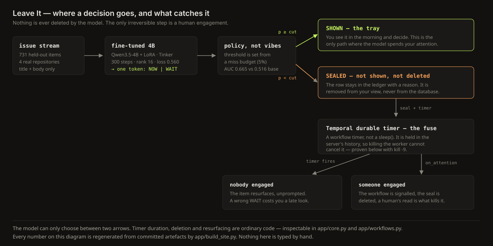

# Leave It

**A morning filter for a backlog you have decided not to read.**

You point it at a stream of items. A fine-tuned 4B open-weight model answers one question per
item — **does this need a human today?** — as a single token. Everything it defers is held by
a durable Temporal fuse rather than dropped, so the decision to ignore something survives a
crash, a reboot, or a closed laptop lid.

Live demo: **https://memeshee.github.io/leaveit/** (mirror: https://leaveit-demo.vercel.app/)

Built for the [Hacktoberfest Open-Source AI Challenge Week 3: Slow and Steady](https://dev.to/challenges/hacktoberfest-week3-2026-10-19).

## The claim, and the number behind it

Evaluated on a **held-out future window** — items created after everything the model trained
on. Every arm is scored at the same operating point: a **5% miss budget**, meaning at most 5%
of the items that genuinely needed a maintainer within 24 hours may be deferred.

| arm | deferred | of pool | AUC |
|---|---|---|---|
| **fine-tuned 4B (Tinker LoRA)** | **73 / 731** | **10.0%** | **0.665** |
| tfidf + hand features | 78 / 731 | 10.7% | 0.663 |
| tfidf + logistic regression | 57 / 731 | 7.8% | 0.634 |
| base 4B, same prompt, no LoRA | 49 / 731 | 6.7% | 0.516 |
| text length only | 28 / 731 | 3.8% | 0.426 |
| already carries a label | 23 / 731 | 3.1% | 0.393 |
| perfect ranker (ceiling) | 496 / 731 | 67.9% | 1.000 |

Read it honestly, because two rows matter more than the others:

- **The fine-tune does not dominate the best classical arm.** AUC 0.665 versus 0.663 is a tie,
  and the TF-IDF arm actually defers 5 more items at exactly the 5% budget. The fine-tune wins
  at the tight budget (64 deferred at 3% versus 44) and at the loose one (152 at 10% versus
  129). If you came for "a small model beats TF-IDF everywhere", this repository is not that.
- **The base model is a coin flip.** AUC 0.516 against a 0.500 baseline. Against the baseline
  this category actually specifies — same model, same prompt, no adapter — the fine-tune moves
  deferral from 49 items to 73 at the same miss budget, and that is the entire justification
  for the training run.

The second axis is cost, measured on the same 40 items with the base model allowed to reason
before it answers:

| arm | verdict produced | tokens per item | tokens for 40 items |
|---|---|---|---|
| base 4B, thinking enabled | **15 / 40** | 696 | 27,837 |
| fine-tuned 4B, verdict as first token | **40 / 40** | 2 | 80 |

Left alone, the reasoning model spent the whole 700-token budget on 25 of 40 items and **never
emitted a verdict at all**; on the 15 it did answer it was 20% accurate. The fine-tune turns
the same weights into a one-token classifier: 348× fewer tokens and a parseable answer every
time.

No latency claim is made. Measured medians were 7.08s (tuned) against 4.03s (base), which is
almost certainly queue and session overhead rather than model time, and a measurement that
contradicts its own expectation is not evidence.

Accuracy is deliberately **not** reported. An arm that says "needs you" to everything is 32%
"accurate" here and saves the user precisely nothing.

## How it works



1. **Score.** The model sees title and body and emits one token. Scoring reads the
   **calibrated probability** of that token via `compute_logprobs`, so there is no sampling
   noise and no second run that can disagree with the first.
2. **Decide, in code.** `app/core.py` turns that number into a decision against a threshold
   derived from the operator's miss budget. The model never decides; it proposes a ranking.
   This boundary is the point of the design.
3. **Seal.** A `WAIT` item leaves your view and enters the ledger with a reason. Nothing is
   deleted. A `SealWorkflow` opens a durable timer — the fuse.
4. **Two exits.** If someone engages, an `on_attention` signal rescues the seal and a human
   read is what removes it. If nobody does, the timer fires and the item resurfaces,
   unprompted.

The four guarantees, in code rather than prose: nothing is deleted, hidden forever, or moved;
every deferral gets a fuse and the fuse is a **server-side timer, not a `sleep`**; one outside
signal unseals an item immediately; the ledger is append-only, so any verdict can be re-read
and argued with.

### The durability claim, as a run rather than an assertion

`app/run_demo.sh` starts a Temporal dev server, opens three seals, kills the worker with
`kill -9`, and delivers a signal **while no worker process exists**. Abridged output:

```
  sealed A  vercel/next.js#100381      p=0.15 fuse=24s  wf=seal-A-1792773234
  sealed B  vercel/next.js#100518      p=0.18 fuse=40s  wf=seal-B-1792773234
  sealed C  vercel/next.js#100398      p=0.20 fuse=16s  wf=seal-C-1792773234
9|kill -9 the worker (pid 1453470)
9|worker is dead: no process exists that could run an activity
9|3 workflows still Running on the server (they were not living in the worker)
11|deliver 'on_attention' to seal B while NO worker process exists
  signal delivered to seal-B-1792773234 (worker alive: no)
16|restart the worker
40|fuses fired; ledger folded from the append-only log:
    vercel/next.js#100398        LAPSED    p=0.20  fuse expired after 16s; nobody ever engaged
    vercel/next.js#100381        LAPSED    p=0.15  fuse expired after 24s; nobody ever engaged
    vercel/next.js#100518        RESCUED   p=0.18  a maintainer commented while the worker was dead
40|server-side run history: 3/3 seals Completed
40|done: 3 seals, 1 kill -9, 1 signal delivered to nobody, 0 fuses lost
```

The timers did not survive because the process was restarted politely. They survived because
they were never in the process: they live in the server's workflow history. That is the whole
argument for Temporal here, and it is why `time.sleep(14 * 86400)` is not an acceptable
implementation of this product.

## Where the data comes from

`data/fetch_issues.py` pulls real issues from real repositories over GitHub GraphQL, including
per-comment timestamps and author associations, so the label can be *maintainer* attention
rather than *anybody replied*. In large repos, passing users pile on with "+1 me too"; counting
that as attention would teach the model the wrong thing.

- `needs_today` — a MEMBER/OWNER/COLLABORATOR commented, or the item was closed, within 24
  hours of arrival.
- Items newer than 24h + margin are dropped, not labelled "no": an outcome that has not
  happened yet is censoring, not signal.
- The split is **temporal**: train on older items, test on the newest window. Shuffling would
  let near-duplicate neighbours leak across the boundary and flatter the score.

Why 24 hours and not 30 days: a 30-day "was it eventually handled" label caps the achievable
payoff near 7%, because almost everything eventually gets touched. At 24 hours the useful
ceiling is 67.9% of the stream. The shorter horizon is the only one where the product has
anything to save you.

Every number in this README and on the demo page is regenerated from committed artefacts by
`eval/policy.py` and `app/build_site.py`. None of them are typed by hand, which is the only
reason they still agree with each other.

## Run it

```bash
git clone https://github.com/memeshee/leaveit && cd leaveit
python3 -m venv .venv && . .venv/bin/activate
pip install -r requirements.txt

# 1. the durability proof needs no API key and no GPU
cd app && ./run_demo.sh          # needs the temporal CLI

# 2. data (needs a GitHub token for GraphQL)
python3 data/fetch_issues.py
python3 data/build_dataset.py    # -> data/train.jsonl (2,924) data/test.jsonl (731)

# 3. baselines — no model required
python3 eval/baselines.py
python3 eval/policy.py eval/scores_*.json

# 4. the model (needs TINKER_API_KEY; training is remote, no local GPU)
export TINKER_API_KEY=...
python3 train/lm.py train tuned 300
python3 train/lm.py score base
python3 train/lm.py score tuned
python3 eval/normalise_lm_scores.py     # p(NOW) -> defer score, explicitly
python3 eval/policy.py eval/scores_tuned.json eval/scores_base.json

# 5. regenerate the demo page from the artefacts above
python3 app/build_site.py        # -> docs/index.html, zero external requests
```

`TINKER_API_KEY` is only needed for step 4. Steps 1, 3 and 5 run on a laptop with no GPU.

## Technology

| | |
|---|---|
| **Fine-tuning** | Tinker — `Qwen/Qwen3.5-4B` LoRA, 300 steps, rank 16, lr 1e-4, 2,924 rows, remote GPU |
| **Durability** | Temporal — `SealWorkflow` with a durable timer and an `on_attention` rescue signal |
| **Storage** | append-only JSONL ledger, folded into state on read; no database to corrupt |
| **Demo** | one self-contained static HTML file generated from the same artefacts the eval reads |
| **Why static** | a demo that depends on a live server is a demo that 404s the week it is judged |

No claims are made beyond Tinker and Temporal. There is no Sentry integration here despite it
being an eligible category, and claiming a category the code does not support would be worse
than skipping it.

## Honest limits

- **The held-out window is 71% `microsoft/vscode`** (518 of 731) while training skews to
  next.js, rust and cpython (956/881/818 against 269). A temporal split over a fast-moving repo
  set drifts in composition, so the headline number is dominated by one project's triage
  rhythm. A per-repo breakdown has not been done and is the first thing worth adding.
- **Four repositories, one 5-day held-out window**: this is a demonstration, not a benchmark.
  The ceiling is a property of these repositories, and a project with a different cadence will
  move it.
- **The label is "a maintainer touched it", which is not "it mattered".** It is a proxy.
- **The fine-tune's raw verdict is poorly calibrated** — it over-predicts `NOW`, which is
  precisely why the product ranks and thresholds instead of trusting the token.
- **A mis-deferral is the expensive error**, so the policy is asymmetric on purpose: it buys
  patience rather than quiet.
- **Not a product.** No auth, no multi-user support, no scheduler; the morning card is
  generated by a script.

## Layout

```
data/     fetch_issues.py (GraphQL), build_dataset.py (label + temporal split), probe_label.py
train/    lm.py (Tinker LoRA: train | score | probe), probe_*.py, state*.json
eval/     policy.py (miss-budget curve, AUC), baselines.py, diagnose.py,
          cost_of_thinking.py, normalise_lm_scores.py, scores_*.json, pnow_*.json
app/      core.py (decisions, ledger), workflows.py (SealWorkflow), worker.py, seal.py,
          run_demo.sh, build_site.py, pick_demo_items.py, fill_post.py, publish_post.py
docs/     index.html (the generated demo page), architecture.svg
post/     the submission article source and its published text
```

## Licence

MIT for the code. Issues fetched from public repositories remain under their own projects'
licences; the derived dataset is used here only for evaluation.
